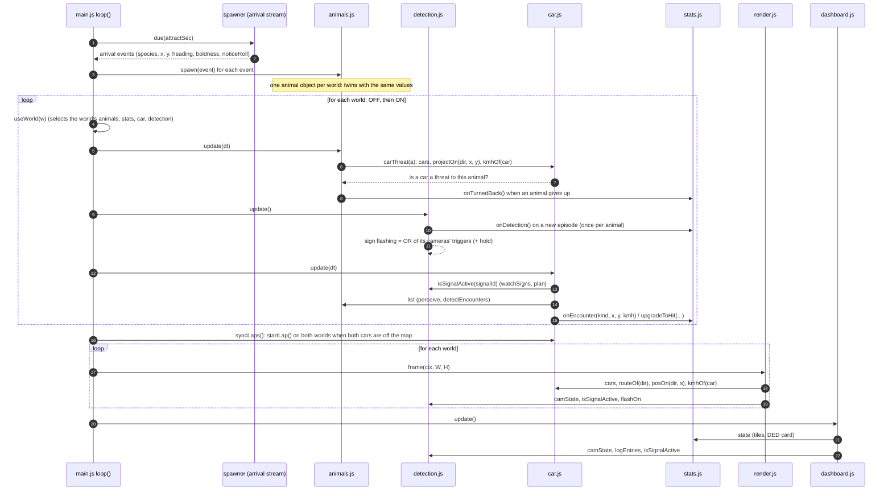
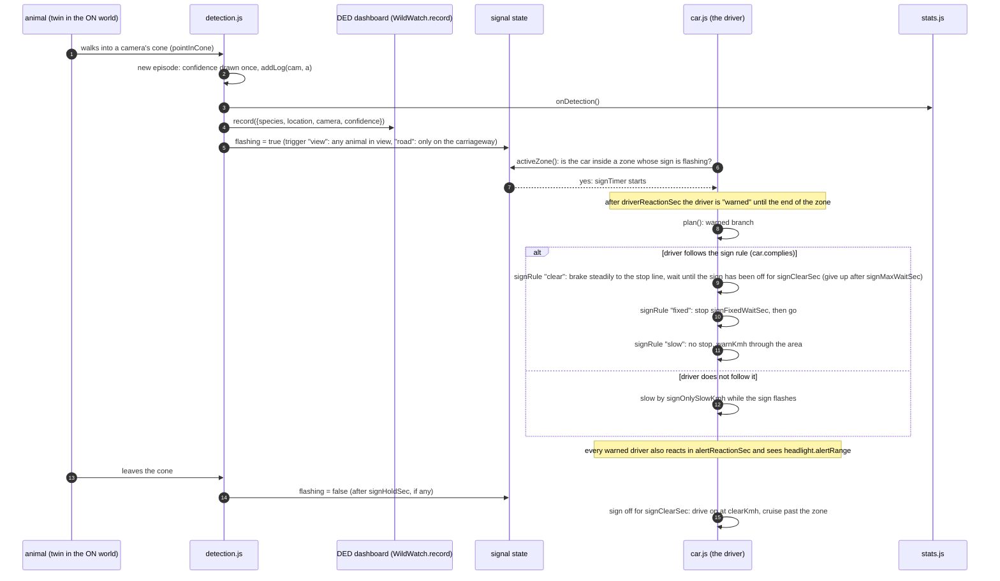
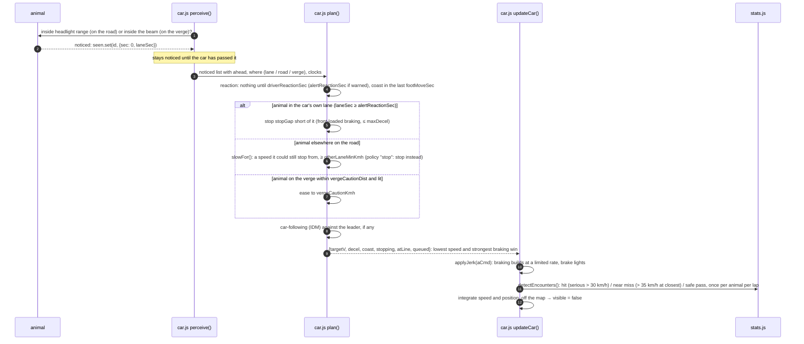
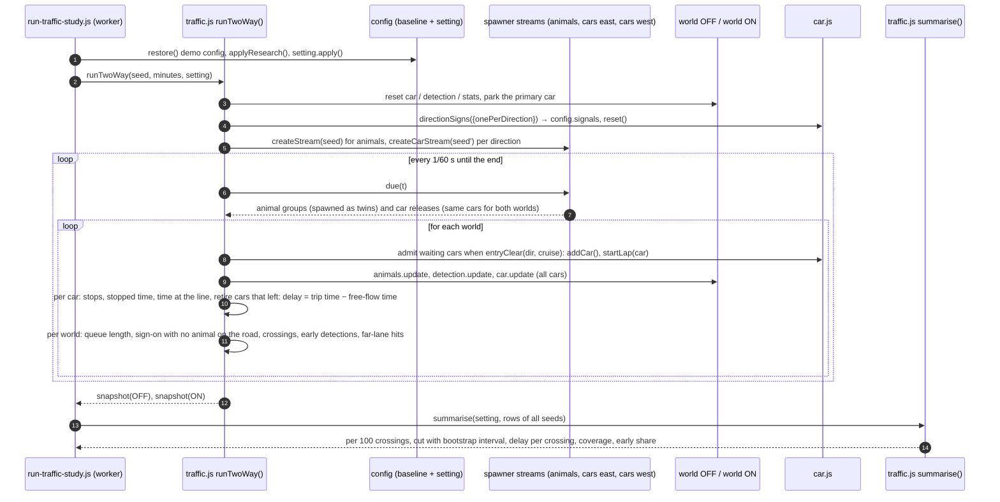
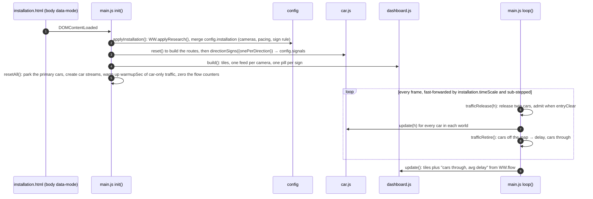

# Sequence diagrams: how the simulation runs

Technical companion to [simulation-model.md](simulation-model.md). Each diagram shows
who calls whom, in order, with the real module and function names from `js/` and
`research/`. The diagrams are Mermaid and render on GitHub; in another viewer, read the
numbered notes under each one.

Participants: **main** (`js/main.js`, the page loop), **spawner** (`js/spawner.js`),
**animals** (`js/animals.js`), **detection** (`js/detection.js`), **car** (`js/car.js`),
**stats** (`js/stats.js`), **render** (`js/render.js`), **dashboard** (`js/dashboard.js`),
**DED** (the vendored `wildwatch-dashboard.js`), **traffic** (`research/traffic.js`).

## 1. One frame of the demo (`index.html`)

Sixty times a second, `main.js loop()` advances the shared animals, then runs detection
and the car for each world (OFF, then ON), then syncs the laps, then draws.

Notes: (2) the spawner draws from a seeded generator, so a run can be replayed. (4) the
same animal exists once per world; each twin reacts to its own world's cars. (6–7) the
roadside decision (`decide` in `animals.js`) looks at every car in the world through
`WW.car.cars`. (9) `detection.update()` only runs the cameras when `WW.system.enabled`
is true, so the OFF world never flashes a sign. (12–14) `car.update()` runs `watchSigns`,
`perceive`, `plan`, the jerk-limited braking, then `detectEncounters`, which reports to
`stats`. (16) in the demo both cars start every lap together.

## 2. From an animal on the verge to a warned driver (ON world)

Notes: (3–4) counted and reported once even if several cameras see the animal. (6) a
zone runs from `signSightDistance` before the sign to the end of the cameras' coverage
of that lane; its stop line is `stopBeforeArea` before the coverage. (10–13) the
`signRule`, `signClearSec`, `signFixedWaitSec`, `signMaxWaitSec`, `signCompliance` and
`signOnlySlowKmh` settings are all in `config.tuning`.

## 3. The driver and an animal in the headlights (either world)

Notes: (1) `seePolicy "nothing"` skips perceive entirely (research baseline). (6) if even
the hardest braking cannot stop in time, `touches()` scores a hit at the contact speed.
(11) the IDM follower uses the car's own cruise speed for its free-road term and notices
the leader's brake lights after `follow.reactionSec`.

## 4. One research run: two worlds, cars both ways (`research/traffic.js runTwoWay`)

Notes: (1) every seed starts from the same config: demo values, research values laid
over, then the setting. (5) the animal stream is seeded by the run seed; the car stream
by a derived seed; both worlds receive the same arrivals so they differ only by the
system. (8) a released car that cannot enter waits off-map and the wait counts as
delay. (12) a hit's speed and lane are captured by the `stats.onEncounter` hook that
`traffic.js` installs at load. The main process runs seeds in 5-seed chunks across
worker threads and summarises with the same `summarise()` the browser page uses, so
both give identical numbers.

## 5. Starting the installation demo (`installation.html`)

Notes: (2) the demo page never calls `applyResearch`, so `index.html` keeps its own
pacing. (3) the signs must exist before the dashboard builds its pills. (5) the warm-up
makes the road carry traffic from the first second, including after Reset.
