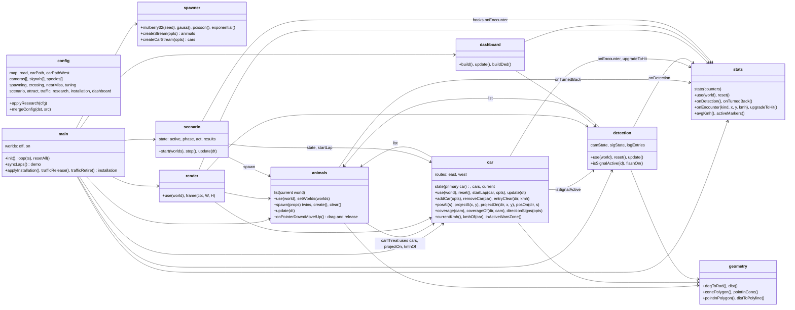
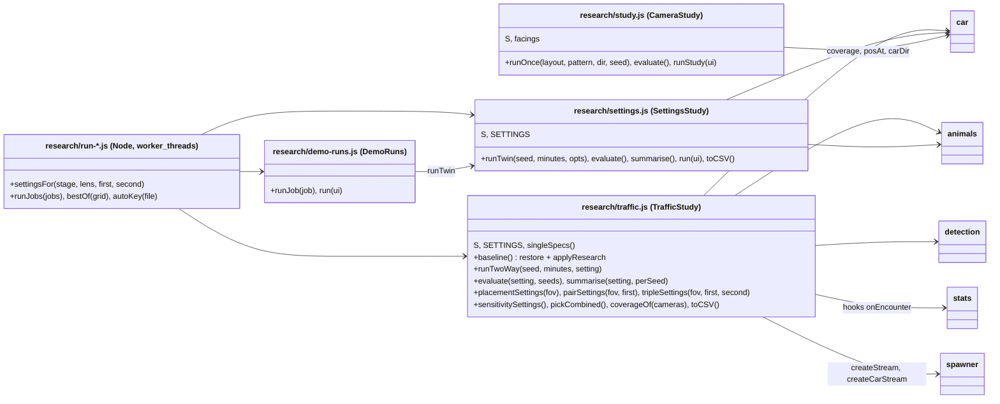
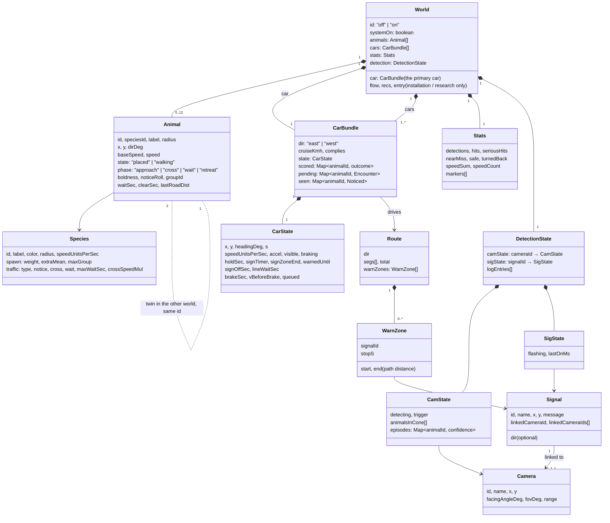
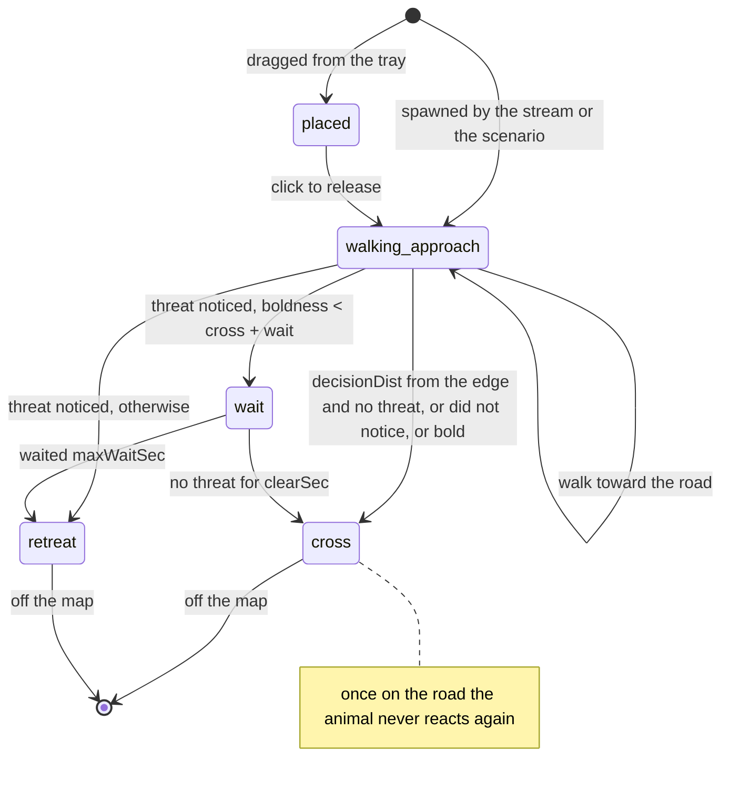
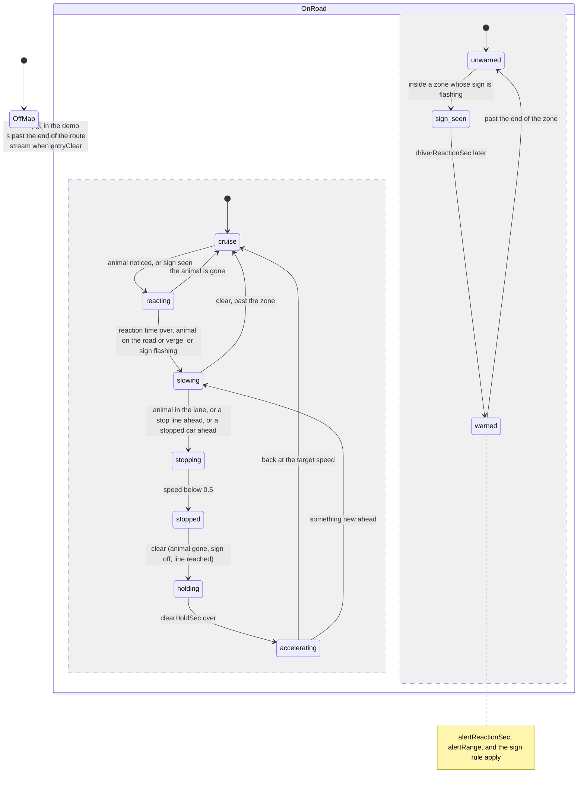
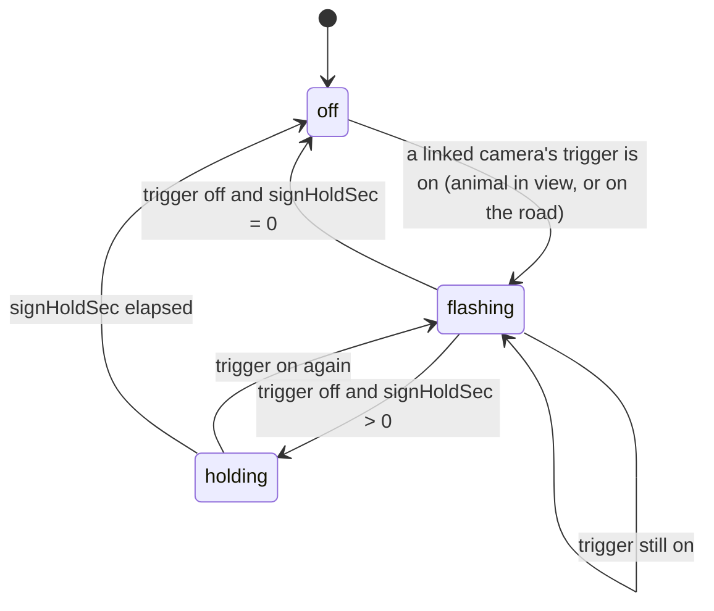
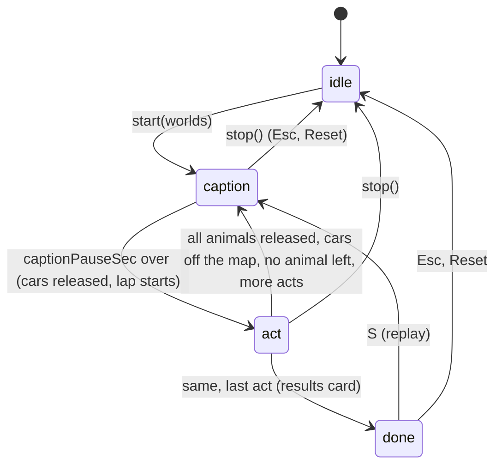
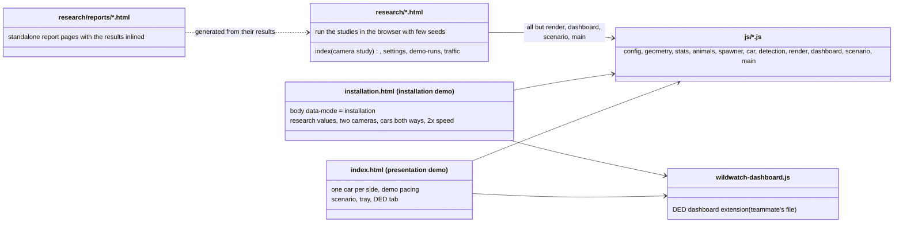

# UML diagrams: structure and states

Technical companion to [sequence-diagrams.md](sequence-diagrams.md) (behaviour over
time) and [simulation-model.md](simulation-model.md) (rules and numbers). This page
shows the **structure** (which modules exist, what they own, how they depend on each
other) and the **state machines** (what an animal, a car, a sign and the scenario can
be doing). The code is plain JavaScript with modules as objects on one global, `WW`;
the class notation below maps each module to a class and each shared data record to a
class, which is how the code is organised even though there is no `class` keyword.

All diagrams are Mermaid and render on GitHub.

## 1. Modules and their dependencies

Arrows point from the module that calls to the module it calls. `config` is read by
everyone and is left out of the arrows.

The research scripts sit on top of the same modules:

## 2. The data model

What a world owns, and what each record holds. A `World` is a plain object that the
modules attach their per-world state to the first time `use(world)` is called.

Notes: a `Route` is shared by all worlds (built from config); each world's cars keep
their own position `s` along it. `cars[0]` is the primary car, the one `WW.car.state`
refers to; the demo only ever has that one.

## 3. State machines

### An animal

### A car (the driver)

Two things are true at once about a car: whether it is warned by a sign, and what it is
doing on the road. Mermaid draws them as two concurrent regions.

### A warning sign

### The preset scenario (`index.html`, key S)

## 4. Pages and what they load

